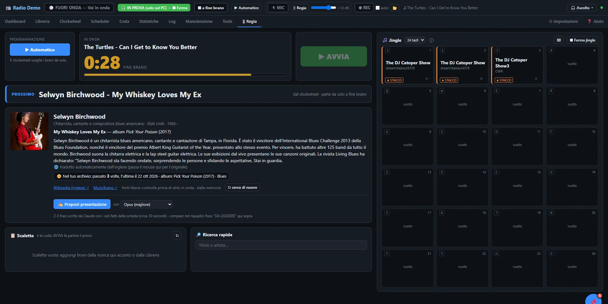
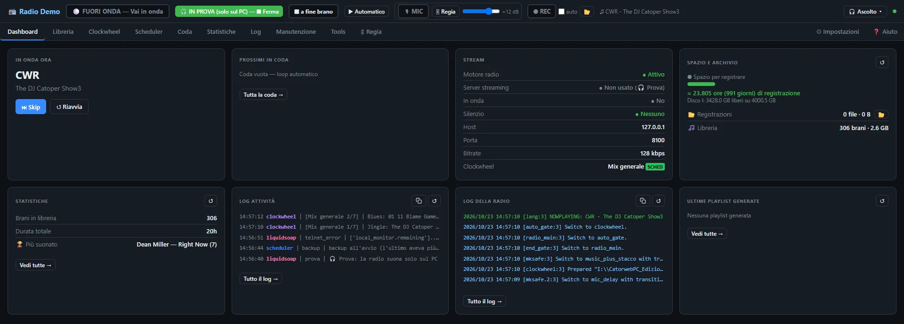
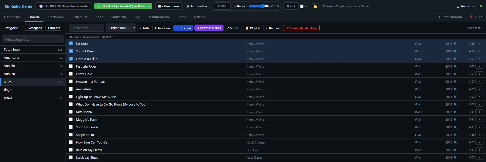

# 📻 Catorweb Broadcaster

**Regia radio per Windows**: suona la tua musica dal PC e la manda in diretta al tuo server di streaming (Icecast, Shoutcast o Liquidsoap).

🇬🇧 *[Read in English](README.md)*

**Per chi è:** web radio amatoriali e di comunità, DJ e podcaster. Fai andare una radio 24 ore su 24 dal PC, oppure conduci dirette con jingle e microfono.

## ⬇ Scarica

👉 **[Ultima versione](../../releases/latest)** → `Setup_CatorwebBroadcaster.exe`

Windows 10 / 11 · gratuito e open source · niente permessi di amministratore

## Cosa fa

- **Libreria** con categorie, import senza copiare i file, Tag Editor, embargo per data
- **Clockwheel** e **Scheduler**: la radio va avanti da sola 24 ore su 24
- **🎛 Studio**: due player con conto alla rovescia, scaletta, modo manuale, da 8 a 32 pulsanti jingle, moduli da sistemare come vuoi
- **🎙 Microfono** con abbassamento automatico della musica e processore della voce
- **▶ Avvia offline**: la radio suona solo sul PC, per ascoltare musica, provare o registrare un podcast
- **⏺ Registrazione** della diretta (anche la sola voce, per il montaggio)
- Interfaccia in **italiano e inglese** · manuale completo in [`manuale/`](manuale/)

| Dashboard | Libreria |
|---|---|
|  |  |

## Cosa serve

- Un PC con **Windows 10 o 11** e i tuoi file musicali (MP3, FLAC, M4A, OGG, WAV).
- Per **andare in onda** serve un account su un **server di streaming** (Icecast o Shoutcast). Molti fornitori lo offrono per pochi euro al mese: indirizzo e password si mettono nelle Impostazioni.
- **Senza server** puoi usare tutto il resto: provare le trasmissioni e registrare podcast sul PC.

## Installare

1. Scarica `Setup_CatorwebBroadcaster.exe` dalla [pagina delle versioni](../../releases/latest).
2. Avvialo. Se Windows mostra **"Il PC è stato protetto"**, clicca **Ulteriori informazioni → Esegui comunque**: il programma è gratuito e non è firmato digitalmente.
3. Al primo avvio compila le **Impostazioni** (nome della radio, cartella della musica, server di streaming).

**Aggiornare:** installa la nuova versione sopra la vecchia, i tuoi dati restano. Il programma ti avvisa quando esce una versione nuova.

## Codice sorgente

Il programma è scritto in Python (server locale + interfaccia HTML) e usa [Liquidsoap](https://www.liquidsoap.info) come motore audio.

| Cartella | Contenuto |
|---|---|
| `app/` | server Python, interfaccia, script Liquidsoap, traduzioni, guida, jingle di esempio |
| `tools/` | strumenti per le traduzioni e la pubblicazione |
| `licenze/` | licenze dei componenti |
| `manuale/` | manuale HTML (italiano e inglese) |
| `build_exe.ps1`, `installer.iss` | creazione del programma e dell'installatore |

**Ricostruirlo**
1. Windows, Python 3.13: `py -3 -m pip install mutagen pyinstaller`
2. Liquidsoap **2.2.4** per Windows ([versione ufficiale](https://github.com/savonet/liquidsoap/releases/tag/v2.2.4)): metti `liquidsoap.exe` nella cartella `liquidsoap/` (non è nel repository: pesa 128 MB).
3. [Inno Setup 6](https://jrsoftware.org/isinfo.php) per creare l'installatore.
4. `powershell -ExecutionPolicy Bypass -File build_exe.ps1` → `build\Setup_CatorwebBroadcaster.exe`

Per provarlo senza compilarlo: `py -3 app\radio_broadcaster_server.py`

## Licenza

Catorweb Broadcaster è software libero, distribuito secondo la **GNU General Public License versione 2 o successiva** ([LICENSE](LICENSE)).
Componenti di terze parti e relative licenze: [`licenze/LICENZE.txt`](licenze/LICENZE.txt). I jingle di esempio in `app/jingle` sono © DJ Catoper, liberi da usare dentro l'app.
